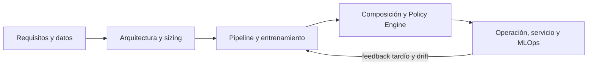
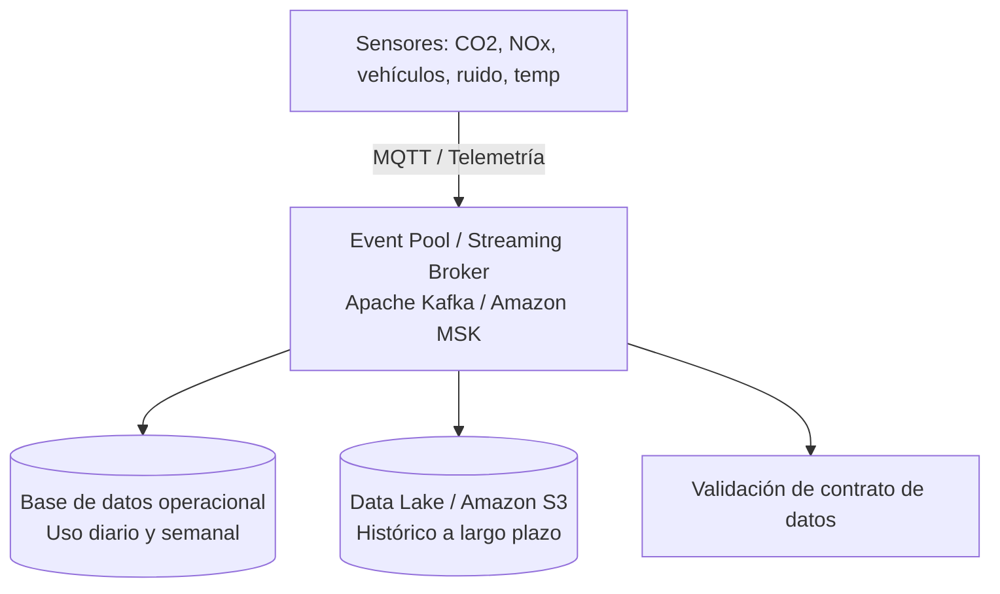
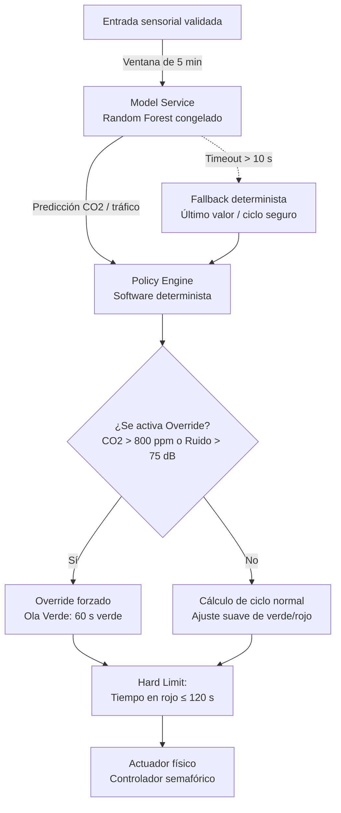
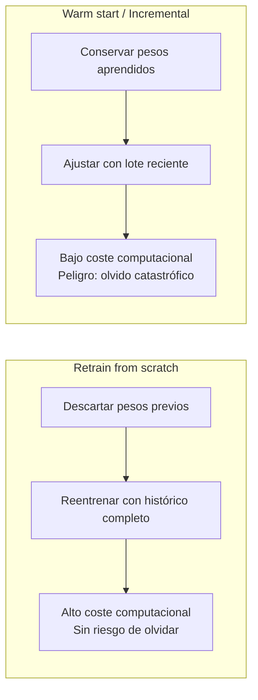
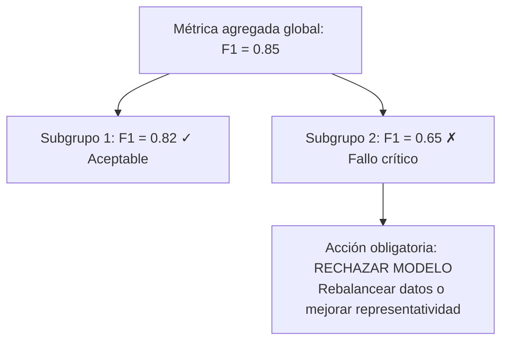
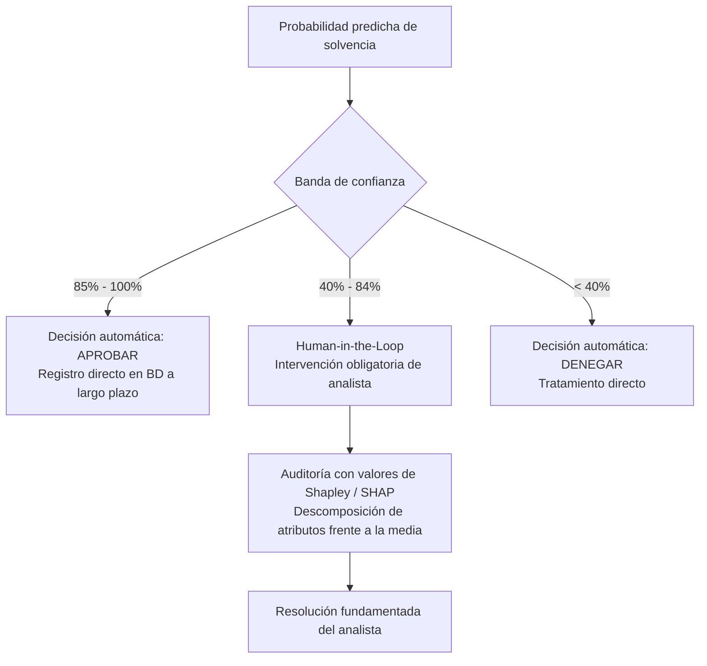
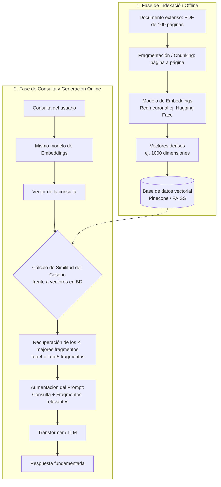

# Apuntes de clase — Martes 13 de octubre de 2026

## Composición del sistema de IA, arquitectura de operación y evaluación en producción

La clase continúa y profundiza los contenidos del **bloque 2 — Architecture and Design**. La sesión se divide en dos grandes ejes temáticos:

1. **Composición de sistemas inteligentes y control físico:** cierre del caso de estudio de control de tráfico y movilidad inteligente, integración de componentes probabilísticos con lógica determinista, restricciones duras de seguridad (*hard constraints*), sustituciones explícitas (*explicit overrides*), protocolos de actuación en el Edge (gRPC frente a JSON) y análisis de fiabilidad en cadena.
2. **Arquitectura y patrones de operación (MLOps):** los tres planos de trabajo (entrenamiento, inferencia y servicio), acuerdos y objetivos de nivel de servicio (SLA frente a SLO), estrategias y disparadores de reentrenamiento (programado, por volumen, por degradación de métricas o por deriva estadística con PSI), prevención de fallos de infraestructura, evaluación equitativa por subgrupos (*fairness*), patrones de servicio (Batch frente a Streaming), supervisión humana en el bucle (*Human-in-the-Loop*) respaldada por explicabilidad con valores de Shapley, y la arquitectura de sistemas RAG (*Retrieval-Augmented Generation*) con Transformers, bases de datos vectoriales y similitud del coseno.

---

## 1. Recorrido del sistema de software para IA

El profesor sitúa la sesión dentro del marco global de la ingeniería de software aplicada a la inteligencia artificial. Hasta este punto se han abordado:

- **Requisitos de software basado en IA:** definición del problema, unidad de observación y formalización de la verdad terreno (*ground truth*).
- **Arquitectura y dimensionamiento:** memoria (RAM/VRAM), energía, capacidades de cómputo (CPU/GPU/TPU) y topologías Cloud frente a Edge.
- **Modelos y propiedades estadísticas:** entrenamiento, funciones de coste, particiones de datos (*train/val/test*) y métricas de evaluación.

El objetivo actual se traslada a la **composición** (cómo interconectar el modelo con el software que lo rodea para interactuar de forma segura con el entorno) y a la **operación en producción** (cómo mantener, monitorizar, servir y actualizar el modelo a lo largo de su ciclo de vida).

El modelo estadístico es únicamente un engranaje dentro del sistema. La responsabilidad de garantizar que las decisiones sean válidas, oportunas y seguras recae en la arquitectura de software.

---

## 2. Composición de sistemas en la práctica: Caso de estudio de movilidad urbana

Para ilustrar la composición entre modelos de IA y software tradicional, la clase retoma y completa el diseño de un **sistema inteligente de control semafórico y mitigación de la contaminación**.

### 2.1. Ingesta sensorial y niveles de persistencia

El sistema monitoriza intersecciones semafóricas complejas mediante una red de sensores desplegados en la vía pública:

- **Magnitudes medidas:** concentración de dióxido de carbono ($\text{CO}_2$) en partes por millón (ppm), partículas de óxidos de nitrógeno ($\text{NO}_x$ en ppm), caudal de vehículos (recuento por minuto o acumulado en ventanas de 5 minutos), nivel de presión acústica / ruido (decibelios, dB) y temperatura ambiental.
- **Transmisión telemétrica:** los sensores transmiten lecturas continuas o muestreadas mediante protocolos ligeros de mensajería (como MQTT o flujos telemétricos especializados).

La arquitectura de persistencia diferencia tres niveles de almacenamiento según su horizonte temporal:

| Nivel de almacenamiento | Tecnología ilustrativa | Finalidad y ciclo de vida |
| --- | --- | --- |
| **Pool de eventos en tiempo real** | Apache Kafka / Amazon MSK | Desacoplamiento de productores y consumidores mediante colas de publicación/suscripción (*pub/sub*). Absorbe picos de tráfico telemétrico. |
| **Almacenamiento operacional** | Base de datos operacional / series temporales | Persistencia a corto plazo (renovada diaria o semanalmente) para inspección de métricas activas, estados de los cruces y alarmas inmediatas. |
| **Histórico a largo plazo** | Almacén de objetos (Amazon S3 / Data Lake) | Archivo masivo de telemetría de años anteriores: registro de violaciones de contrato, probabilidades emitidas por el modelo, métricas de calidad y alarmas de deriva remitidas a la dirección técnica (CTO/C-level). |

### 2.2. Validación del contrato de datos en la frontera

Antes de que las lecturas sensoriales lleguen a cualquier etapa de cálculo o predicción, deben superar el **Data Contract** en tiempo de ejecución:

1. **Integridad estructural:** comprobación de presencia de todas las columnas esperadas.
2. **Orden estricto:** correspondencia posicional exacta de los campos; un intercambio accidental entre dos magnitudes numéricas (por ejemplo, intercambiar edad por altura o temperatura por concentración de $\text{CO}_2$) no provoca un error de tipos en la máquina, pero corrompe la predicción.
3. **Tipado y coherencia:** tipos de datos conformes al esquema (enteros, coma flotante, marcas de tiempo).
4. **Rangos físicos admisibles:** descarte de lecturas absurdas derivadas de averías sensoriales (por ejemplo, temperaturas imposibles de millones de grados bajo cero, edades humanas superiores a 120 años o recuentos negativos de vehículos).
5. **Tratamiento de valores ausentes:** aplicación de políticas predeterminadas de imputación o señalización mediante banderas indicadoras.

### 2.3. Ingeniería de características en tiempo real: ventanas y gradientes

El modelo predictivo no procesa el flujo sensorial infinito de manera continua, sino que se alimenta a partir de una ventana acotada:

- **Ventana deslizante (*Sliding Window* o *Diving Window*):** se agregan los datos de los últimos 5 minutos para predecir el comportamiento del tráfico y la polución en el siguiente horizonte de 5 minutos.
- **Valores absolutos frente a deltas ($\Delta$):** el profesor destaca la relevancia de calcular la diferencia entre lecturas consecutivas:
  $$\Delta \text{CO}_{2, t} = \text{CO}_{2, t} - \text{CO}_{2, t-1}$$
  Mientras que el valor absoluto indica el nivel actual de polución (por ejemplo, $800\text{ ppm}$), el delta aporta el **gradiente o signo de la tendencia**:
  - $\Delta > 0$: la concentración está aumentando rápidamente.
  - $\Delta < 0$: la concentración se encuentra en remisión.

> **Criterio docente:** Usar exclusivamente los valores absolutos o exclusivamente los deltas descarta información vital. La combinación de ambos (magnitud presente + dirección del cambio) proporciona a los modelos y a las funciones de decisión una capacidad superior para anticipar saturaciones.

### 2.4. Empaquetado del modelo y consideraciones de seguridad

El componente inteligente reside como un servicio empaquetado:

- **Estado congelado (*Frozen Weights*):** el modelo se despliega con sus pesos fijados y empaquetado junto a sus dependencias en una imagen de contenedor (Docker). No se reentrena en caliente con cada solicitud.
- **Pipeline integrado:** el contenedor incluye el estimador ajustado (por ejemplo, un ensamblado de árboles *Random Forest* de scikit-learn) y los transformadores de datos (medias y medianas de imputación calculadas en la fase de entrenamiento).
- **Riesgos de deserialización con `pickle`:** el profesor reitera una advertencia de seguridad crítica: el formato estándar de serialización de Python (`pickle`, cargado habitualmente mediante `joblib.load`) puede contener código arbitrario ejecutable. Cargar modelos en formato pickle descargados de orígenes no verificados expone la infraestructura al compromiso total mediante inyección de malware. Para almacenar pesos de modelos, es preferible utilizar formatos de serialización exclusivamente numéricos (como SafeTensors) o estándares abiertos interoperables (como ONNX).

---

## 3. El Policy Engine determinista y la gobernanza del modelo

Un principio arquitectónico esencial en la ingeniería de IA es la **separación estricta entre predicción y actuación**:

> **Regla de oro:** Los modelos de IA son componentes estadísticos y estocásticos: estiman probabilidades, clasifican patrones o predicen valores continuos, pero **nunca deben accionar directamente el mundo físico ni ejecutar transacciones críticas**. El control corresponde a software determinista tradicional (el *Policy Engine*).

### 3.1. Gestión de latencia, timeouts y rutas de fallback

El controlador del semáforo requiere una consigna determinista para iniciar su siguiente ciclo (por ejemplo, cada 5 minutos). Si la llamada a la función predictiva `model.predict()` queda bloqueada:

- Se define un **timeout estricto** en el cliente (por ejemplo, 10 segundos).
- Si el modelo no devuelve una respuesta antes de que expire el temporizador, el software de control cancela la espera y activa una **estrategia de contingencia (*fallback*)**:
  1. Reutilizar la predicción del ciclo anterior o un valor de referencia predeterminado.
  2. Registrar la incidencia en la telemetría del sistema.
  3. Si los timeouts se vuelven repetitivos (por ejemplo, 10 caídas en una misma mañana), generar una alarma urgente para el operador técnico.

### 3.2. Optimización multiobjetivo y envolvente convexa (*Convex Hull*)

El control del tráfico urbano plantea un problema clásico de **objetivos en conflicto**:

1. **Minimizar la polución:** ampliar fases verdes en vías con alta concentración de emisiones para evitar que los vehículos aceleren y frenen continuamente en retenciones.
2. **Minimizar los tiempos de demora vehicular:** alternar fases con fluidez para evitar colapsar las calles secundarias y reducir los tiempos de viaje.

En sistemas de movilidad inteligente (*Smart Mobility*), este equilibrio suele formularse como una **combinación lineal** en la función de coste. El docente introduce una aclaración matemática fundamental:

- La optimización mediante combinaciones lineales garantiza alcanzar el óptimo si el espacio de búsqueda es **convexo** (dentro de la envolvente convexa o *convex hull*).
- Si la dinámica del tráfico y la dispersión de contaminantes en la ciudad no forman un sistema convexo, la combinación lineal puede no alcanzar el óptimo global teórico.
- No obstante, en la ingeniería real no se requiere un óptimo matemático inalcanzable: no existe una ecuación analítica completa ni un simulador perfecto de una ciudad entera. La combinación de predicciones con políticas heurísticas robustas proporciona mejoras operativas drásticas frente a la ausencia de regulación adaptativa.

### 3.3. Restricciones duras (*Hard Constraints*) y disparadores de sustitución (*Override Triggers*)

El *Policy Engine* incorpora salvaguardas que se evalúan **siempre**, con independencia de la salida del modelo:

#### Restricción dura (*Hard Limit*)
El tiempo de espera en fase roja para cualquier vía regulada nunca puede exceder los **120 segundos**, independientemente de lo que proponga la optimización:
$$\text{tiempo\_rojo} = \min(\text{tiempo\_calculado}, 120)$$

#### Disparador de sustitución explícita (*Explicit Override Trigger*)
Si las condiciones ambientales superan límites de riesgo para la salud pública o la habitabilidad urbana:
$$\text{Si } \text{CO}_2 > 800\text{ ppm} \quad\text{o}\quad \text{Ruido} > 75\text{ dB} \implies \text{Override Trigger activo}$$

- **Comportamiento del Override:** se anula y descarta completamente la salida del modelo. El sistema entra de forma obligatoria en modo de evacuación forzada, fijando el semáforo en **verde durante 60 segundos** (el límite máximo permitido de verde).
- **Efecto Ola Verde (*Green Wave*):** al propagarse esta orden a lo largo de intersecciones consecutivas, se genera una ola verde sincronizada que desaloja los vehículos del corredor congestionado, reduciendo drásticamente las emisiones acumuladas.

### 3.4. Traza temporal de ejecución: evolución paso a paso

El profesor detalla una secuencia numérica para observar la interacción dinámica entre el sensor, el modelo y la política:

| Paso temporal | Lectura real del sensor | Variación observada ($\Delta$) | Predicción del modelo | Estado del Override ($\text{CO}_2 > 800$) | Acción de control adoptada |
| :---: | :---: | :---: | :---: | :---: | :--- |
| **Instante 1** | $790\text{ ppm}$ | $+10\text{ ppm}$ | $795\text{ ppm}$ | **Inactivo** ($795 \le 800$) | **Ciclo normal:** el modelo gobierna los tiempos de verde y rojo mediante su fórmula adaptativa. |
| **Instante 2** | $795\text{ ppm}$ *(acierto exacto)* | $+5\text{ ppm}$ | $815\text{ ppm}$ | **Activo** ($815 > 800$) | **Override Trigger:** se ignora el modelo. Se fuerza verde a 60 segundos para desalojar el cruce. |
| **Instante 3** | $790\text{ ppm}$ *(polución en descenso)* | $-5\text{ ppm}$ | $780\text{ ppm}$ | **Inactivo** ($780 \le 800$) | **Retorno a ciclo normal:** la evacuación forzada redujo la polución. Se desactiva el override y se retoma la regulación estándar. |

---

## 4. Actuación en el Edge y fiabilidad en sistemas compuestos

### 4.1. Comunicación de control: gRPC frente a JSON

Para transmitir las consignas desde el servidor de decisiones hacia los controladores físicos de los semáforos, el docente analiza el impacto del protocolo de comunicación:

- **La ineficiencia de JSON:** enviar un mensaje como `{"command": "set_phase", "color": "green", "duration_seconds": 45}` para transmitir un simple número entero (`45`) conlleva una sobrecarga textual desproporcionada. Los nombres de campo, delimitadores y serialización en texto inflan el tamaño del paquete IP que viaja sobre TCP.
- **Ventajas de gRPC (*Google Remote Procedure Call*):**
  - Utiliza serialización binaria compacta mediante **Protocol Buffers** (`.proto`).
  - La llamada a procedimiento remoto transmite los datos tipados de forma binaria, ultraligera y síncrona.
  - El fichero `.proto` formaliza el **contrato ejecutable** estricto que comparten emisor y receptor.
  - Ofrece confirmación garantizada de recepción sobre HTTP/2.

### 4.2. Superficie de ataque en dispositivos Edge

Los semáforos físicos de las ciudades modernas albergan microcomputadores industriales o controladores embebidos que ejecutan sistemas operativos convencionales:

- **Windows:** presenta una amplia superficie de ataque expuesta a virus y vulnerabilidades si no se aísla rigurosamente.
- **Distribuciones ligeras de Linux (como Debian embebido):** facilitan un entorno minimalista, controlado y auditable para ejecutar el agente receptor gRPC.

### 4.3. Degradación de disponibilidad en arquitecturas compuestas

Uno de los errores conceptuales más frecuentes en la ingeniería de sistemas distribuidos consiste en evaluar la fiabilidad de los componentes de forma aislada sin calcular el impacto de la cadena completa.

Si una ruta de decisión requiere que **8 etapas independientes** funcionen consecutivamente (sensor $\to$ ingesta en Kafka $\to$ extracción de características $\to$ servicio predictivo $\to$ motor de reglas $\to$ red de comunicaciones $\to$ receptor gRPC $\to$ actuador físico), y cada etapa ofrece una disponibilidad individual aparentemente alta del **99 %** ($0{,}99$):

$$A_{\text{total}} = \prod_{i=1}^{8} A_i = 0{,}99^8 \approx 0{,}9228 \quad (92{,}28\%)$$

> **Impacto operativo:** Una disponibilidad global del $92{,}28\%$ implica una indisponibilidad acumulada del $7{,}72\%$, lo que equivale aproximadamente a **1 hora y 51 minutos de caída al día**. Para un sistema semafórico que debe recibir consignas cada 5 minutos, una parada de casi dos horas resulta inaceptable.

### 4.4. Checklist de aceptación de la composición (*Composition Gates*)

Antes de autorizar la entrega de un sistema compuesto a operación, deben validarse cuatro puertas de paso:

1. **Gate 1 — Desacoplamiento:** la predicción del modelo está estrictamente desacoplada de la acción mecánica; existe una capa intermedia de reglas que valida y modula la salida.
2. **Gate 2 — Latencia de extremo a extremo:** la suma de los tiempos de todas las etapas (sensores, red, cómputo, política) es holgadamente inferior a la ventana temporal del ciclo (5 minutos).
3. **Gate 3 — Restricciones duras y Overrides explícitos:** el código contiene condiciones de seguridad verificables (como el límite de 120 s en rojo y el override por ruido o $\text{CO}_2$).
4. **Gate 4 — Tolerancia ante caídas en cascada y Fallback:** cada etapa cuenta con un timeout configurado y una política de contingencia segura si falla el servicio upstream.

---

## 5. Arquitectura y planos de operación (Training, Inference y Prediction)

En la segunda mitad de la clase, el profesor traslada el foco a la **fase de operaciones (MLOps)**, diferenciando con precisión los tres planos de trabajo que intervienen en un sistema con IA:

```mermaid
flowchart TD
    subgraph Plano 1: Training [Plano de Entrenamiento]
        T1[Datos históricos limpios por lotes] --> T2[Ajuste intensivo de pesos en GPU/TPU]
        T2 --> T3[Requiere etiquetas de Ground Truth]
    end
    subgraph Plano 2: Inference [Plano de Inferencia]
        I1[Flujo de datos del mundo real] --> I2[Ejecución forward con pesos congelados]
        I2 --> I3[Etiquetas no disponibles de inmediato]
    end
    subgraph Plano 3: Prediction & Serving [Plano de Servicio y Decisión]
        P1[Inferencia calculada] --> P2[Aritmética elemental: umbrales, min/max]
        P2 --> P3[Sujeto a SLA/SLO estricto]
    end
```

| Dimensión | 1. Entrenamiento (*Training*) | 2. Inferencia (*Inference*) | 3. Predicción y Servicio (*Prediction*) |
| --- | --- | --- | --- |
| **Objetivo** | Aprender los parámetros internos (pesos) del modelo. | Ejecutar el modelo con pesos congelados sobre una entrada. | Interpretar la salida para generar una decisión o puntuación utilizable. |
| **Naturaleza de los datos** | Datos históricos curados y limpios, suministrados por lotes (*batches* de 64 a 64.000 muestras). | Datos del mundo real en tiempo real o en lotes, con posibles irregularidades o ruido. | Registro puntual o vector de puntuaciones (*scores*) para una entidad específica. |
| **Disponibilidad de etiquetas (*Ground Truth*)** | **Obligatoria e imprescindible:** se necesitan etiquetas para calcular la función de pérdida. | **Ausente en el momento de la inferencia:** el resultado real solo se conoce a posteriori (feedback demorado). | No aplica directamente; el servicio emite una respuesta inmediata. |
| **Demanda de cómputo** | Cálculo masivo de gradientes en aceleradores dedicados (GPU o TPU). | Paso hacia adelante (*forward pass*), habitualmente en CPU o TPU con memoria acotada. | Aritmética elemental (sumas ponderadas, comparaciones de umbrales, mínimos o máximos). |
| **Cadencia temporal** | Horas, días o semanas; planificación diferida. | Milisegundos o segundos según la carga. | Microsegundos o milisegundos; en línea con el servicio. |

### 5.1. Acuerdos y objetivos de nivel de servicio: SLA frente a SLO

El profesor clarifica una distinción habitual en la gestión operativa:

- **SLO (*Service Level Objective*):** es un **valor métrico concreto y medible** que define el umbral aceptable de calidad o rendimiento.
  - *Ejemplos:* latencia máxima de respuesta en inferencia ($P_{95} \le 200\text{ ms}$), disponibilidad del servicio ($\ge 99{,}9\%$) o límite de tiempo en caída.
  - Los SLO pueden representar valores máximos, mínimos o rangos cuantitativos.
- **SLA (*Service Level Agreement*):** es el **documento contractual formal** que agrupa los SLO comprometidos, define los términos legales, asigna responsabilidades operativas y establece compensaciones económicas o penalizaciones en caso de incumplimiento.

---

## 6. Estrategias y disparadores de reentrenamiento

Cuando la monitorización del modelo en producción evidencia una degradación del rendimiento o un cambio sustancial en los datos, es necesario reentrenar. El profesor detalla las dos aproximaciones fundamentales y sus compensaciones:

### 6.1. Reentrenamiento desde cero (*Retrain from scratch*) frente a Warm Start

| Estrategia | Mecanismo | Ventajas | Inconvenientes y riesgos |
| --- | --- | --- | --- |
| **Reentrenamiento desde cero (*From Scratch*)** | Se reinician los pesos y se ajusta un modelo nuevo utilizando todo el corpus histórico acumulado y depurado. | Elimina distorsiones acumuladas y se adapta a cambios estructurales mayores de la distribución. | **Coste elevado:** requiere días o semanas de cómputo intenso en GPU/TPU y almacenamiento masivo. |
| **Aprendizaje incremental (*Warm Start / Fine-tuning*)** | Se conservan los pesos existentes y se actualizan con los datos nuevos que van llegando. | **Coste muy reducido:** el ajuste es rápido y demanda una fracción del cómputo. | **Olvido catastrófico (*Catastrophic Forgetting*):** el modelo puede sobreescribir patrones esenciales consolidados del pasado para ajustarse a anomalías transitorias recientes. |

> **Criterio de elección:** En entornos sumamente dinámicos y volátiles (donde los patrones pasados pierden validez con rapidez), el aprendizaje incremental resulta adecuado. En dominios estables o críticos, donde solo cambian unas pocas variables aisladas, es preferible preservar el conocimiento histórico o recurrir a reentrenamientos desde cero controlados.

### 6.2. Disparadores de reentrenamiento (*Retraining Triggers*)

El reentrenamiento no se efectúa al azar; se acciona mediante disparadores explícitos:

1. **Disparador programado (tiempo calendario):** reentrenamiento periódico prefijado (por ejemplo, el primer día de cada mes).
2. **Disparador por volumen de datos:** cuando el volumen de nuevas observaciones supera un umbral estadísticamente representativo (por ejemplo, tras acumular 10.000 nuevas transacciones de clientes).
3. **Disparador por degradación de métricas:** cuando las métricas de rendimiento ($F_1\text{-score}$, *accuracy*, *recall*), calculadas a medida que se recuperan las etiquetas demoradas, caen por debajo de un umbral aceptable (por ejemplo, descender del $95\%$ al $80\%$).
4. **Disparador por deriva de datos (*Data Drift* con PSI):** monitorización estadística de la distribución de las variables de entrada frente a las del conjunto de entrenamiento mediante métricas como el **Population Stability Index (PSI)** o el contraste de Kolmogorov-Smirnov (KS):
   - Un valor de $\text{PSI} > 0{,}25$ en una variable revela un desplazamiento significativo de la distribución.
   - El docente enfatiza que si una única columna supera el umbral de $0{,}25$, puede ser asumible; pero si **3, 4 o 5 columnas presentan simultáneamente un $\text{PSI} > 0{,}25$**, el reentrenamiento se convierte en una necesidad ineludible.

### 6.3. Verificación de infraestructura previa al reentrenamiento

El profesor formula una advertencia operativa crítica para cualquier equipo de producción:

> **Regla de diagnóstico:** Ante una alarma de caída de rendimiento o deriva en los datos, **lo primero que debe comprobarse es si el pipeline o los sensores están rotos**.  
> Si un sensor físico de temperatura o de $\text{CO}_2$ sufre una avería y comienza a transmitir ruido o valores disparatados, la respuesta jamás consiste en reentrenar el modelo con esos datos degradados. La acción correcta es corregir la avería del sensor o depurar el pipeline. Solo se reentrena cuando se confirma que los datos reflejan un cambio real y fidedigno del entorno.

---

## 7. Análisis de equidad en subgrupos y control de sobreajuste

### 7.1. Rendimiento desagregado por subgrupos (*Subgroup Analysis / Fairness*)

Un modelo con una métrica agregada sobresaliente puede esconder fallos catastróficos o sesgos discriminatorios en subpoblaciones específicas.

- **El caso de selección de personal de Amazon:** el docente menciona el célebre ejemplo del sistema automatizado de contratación que discriminaba sistemáticamente los currículums de mujeres al haber sido entrenado con historiales históricos mayoritariamente masculinos.
- **El caso bancario de concesión de créditos:** al evaluar la probabilidad de devolución de un préstamo en diferentes grupos demográficos, una métrica global de $F_1 = 0{,}85$ puede enmascarar que el subgrupo 1 obtiene un $0{,}82$ mientras el subgrupo 2 cae a un inaceptable $0{,}65$.

> **Criterio de rechazo de modelos:** Si una nueva versión reentrenada mejora la media global del sistema pero presenta una regresión en cualquiera de los subgrupos críticos por debajo del umbral mínimo fijado, el nuevo modelo **debe ser rechazado**. Es imperativo rebalancear los datos o dotar a dicho subgrupo de mayor representatividad.

### 7.2. Partición estratificada (*Stratified Splits*)

Para garantizar la representatividad en el entrenamiento y la evaluación:

- Si un subgrupo minoritario constituye el **5 %** del conjunto total de datos, las particiones de entrenamiento, validación y prueba (*train, validation, test splits*) deben construirse de manera estratificada para mantener exactamente esa proporción del **5 %** en cada una de ellas.
- **Distinción terminológica:** el profesor recuerda que un *split* es una partición estática de los datos, mientras que un *fold* corresponde a las iteraciones de particionado en procedimientos de validación cruzada (*cross-validation*).

### 7.3. Detección de sobreajuste (*Overfitting*)

La comparación continua entre las métricas de entrenamiento y validación señala cuándo el modelo memoriza en lugar de aprender:

$$\text{Accuracy}_{\text{train}} \approx 90\% \quad\text{frente a}\quad \text{Accuracy}_{\text{val}} \approx 60\text{--}70\% \implies \text{Overfitting evidente}$$

Una brecha pronunciada entre ambos conjuntos invalida la versión candidata y exige regularización o ajuste de hiperparámetros.

---

## 8. Patrones de servicio: Por lotes (Batch) frente a Tiempo real (Streaming)

La arquitectura de despliegue depende de las restricciones temporales del negocio:

| Dimensión | Servicio por lotes (*Batch Serving*) | Servicio en tiempo real (*Online / Streaming*) |
| --- | --- | --- |
| **Escenario típico** | Procesamiento nocturno de solicitudes de crédito para los gestores del día siguiente. | Evaluación de riesgo inmediata mientras el cliente tramita una operación en ventanilla o web. |
| **Compromiso temporal (SLA)** | Horas o días; márgenes temporales amplios y relajados. | Milisegundos o segundos; respuesta interactiva estricta. |
| **Perfil de cómputo** | Consumo concentrado en picos intensos durante la ejecución del lote; inactivo el resto del tiempo. | Consumo continuo y sostenido con el modelo siempre cargado en memoria. |
| **Estrategia de contingencia (*Fallback*)** | **Relajada:** se puede detener la ejecución, depurar el problema, ajustar el código y relanzar el lote. | **Inmediata y determinista:** se deben servir valores por defecto en caché, reglas heurísticas o modelos simplificados en disco. |

---

## 9. Human-in-the-Loop (HITL) y explicabilidad con valores de Shapley

En sistemas críticos (como la banca o la salud), la automatización total no siempre es admisible. El profesor describe cómo estructurar la **supervisión humana en el bucle (*Human-in-the-Loop*)** mediante bandas de confianza:

### 9.1. Bandas de confianza (ejemplo de concesión crediticia)

- **Alta confianza ($85\%\text{--}100\%$):** el modelo presenta certidumbre elevada; la operación se aprueba automáticamente sin intervención humana y se almacena en el registro histórico.
- **Baja confianza ($< 40\%$):** la probabilidad de impago es manifiesta; la solicitud se deniega o se procesa por la vía ordinaria de descarte.
- **Zona de incertidumbre intermedia ($40\%\text{--}84\%$):** el riesgo es ambiguo. En este intervalo **la intervención humana es obligatoria (*Human-in-the-Loop*)**. La solicitud se transfiere a un analista experto para su valoración.

### 9.2. Explicabilidad con valores de Shapley (SHAP)

Cuando el caso pasa al analista humano, este necesita comprender **por qué** el modelo asignó una probabilidad concreta:

- Si el modelo presenta una probabilidad base/media del $60\%$ para perfiles estándar, pero para un cliente determinado calcula un $85\%$ (o una caída al $25\%$), el analista no puede confiar a ciegas en esa cifra.
- La técnica de **valores de Shapley (SHAP)** descompone la diferencia entre la predicción individual y la media de referencia en contribuciones aditivas por cada atributo:

| Característica del cliente | Contribución calculada | Interpretación para el revisor humano |
| --- | :---: | --- |
| **Nivel de ingresos salariales** | $+10\%$ | Salario estable por encima del percentil de referencia. |
| **Historial crediticio previo** | $+10\%$ | Cumplimiento intachable de préstamos pasados con la entidad. |
| **Otros factores (antigüedad, saldo)** | $+5\%$ | Bonificación acumulada por estabilidad financiera. |
| **Total predicción final** | **$85\%$** | $60\% \text{ (base)} + 10\% + 10\% + 5\% = 85\%$ |

Esta descomposición matemática permite a la persona auditar si el modelo se apoya en evidencias legítimas antes de ratificar o rectificar la concesión.

---

## 10. Modelos generativos y arquitecturas RAG en producción

En el tramo final de la clase, el profesor introduce la operativa de los modelos basados en **Transformers** y la arquitectura **RAG (*Retrieval-Augmented Generation*)**:

- **Limitaciones de los Transformers:** son redes densas de capas de atención y perceptrones cuyos pesos son estáticos tras el entrenamiento. Ante consultas sobre documentos recientes o específicos, tienden a alucinar o a emitir respuestas imprecisas.
- **Solución RAG:** en lugar de reentrenar el Transformer para cada nuevo documento, se le suministra el contexto pertinente junto con la consulta del usuario.

### 10.1. El pipeline de RAG paso a paso

1. **Fragmentación (*Chunking*):** un documento extenso (por ejemplo, un manual o PDF de 100 páginas) se divide en unidades manejables (por páginas o fragmentos de texto).
2. **Modelo de Embeddings:** cada fragmento textual se procesa mediante un modelo de embeddings (descargado de plataformas como Hugging Face), que proyecta el texto en un **vector numérico denso** de alta dimensionalidad (por ejemplo, 1.000 dimensiones).
3. **Almacenamiento vectorial:** los vectores y sus textos asociados se indexan en una **base de datos vectorial** especializada:
   - *Servicio gestionado en la nube:* Pinecone.
   - *Librería de búsqueda local / embebida:* FAISS (Facebook AI Similarity Search).
4. **Vectorización de la consulta:** al recibir una pregunta del usuario, se procesa con el *mismo* modelo de embeddings para obtener el vector correspondiente.
5. **Cálculo de similitud:** se compara el vector de la consulta con todos los vectores de la base de datos mediante la **similitud del coseno**.
6. **Recuperación y aumentación:** se seleccionan los $k$ fragmentos más afines (por ejemplo, los 4 o 5 mejores) y se concatenan a la pregunta original. El Transformer recibe así la consulta junto al contexto fáctico necesario para responder sin alucinar.

### 10.2. Formalización matemática: Similitud del Coseno

La métrica empleada para cuantificar la afinidad semántica entre dos vectores $\mathbf{u}$ y $\mathbf{v}$ en el espacio latente es la **similitud del coseno**:

$$\text{Similitud de Coseno}(\mathbf{u}, \mathbf{v}) = \frac{\mathbf{u} \cdot \mathbf{v}}{\|\mathbf{u}\| \|\mathbf{v}\|} = \frac{\sum_{i=1}^{n} u_i v_i}{\sqrt{\sum_{i=1}^{n} u_i^2} \sqrt{\sum_{i=1}^{n} v_i^2}}$$

- El numerador es el **producto escalar** de ambos vectores.
- El denominador es el producto de sus **normas euclídeas** ($\|\mathbf{u}\| = \sqrt{\sum u_i^2}$).
- La normalización por las normas hace que la métrica dependa exclusivamente del **ángulo** entre los vectores y no de su magnitud.
- Cuanto más próximo a $1$ se sitúe el resultado, mayor es la similitud semántica.

> **Precisión docente sobre distancias:** En sistemas de IA de procesamiento de lenguaje natural y embeddings, la similitud del coseno es la métrica predominante, frente a alternativas como la distancia de Hamming (adecuada para cadenas de bits o categorías) o distancias euclídeas puras.

### 10.3. Auditoría y métricas de evaluación de RAG

El diseño de un sistema RAG exige auditar rigurosamente la calidad de la fase de recuperación (*retrieval*):

$$\text{Recall} = \frac{|\text{Documentos Relevantes Recuperados}|}{|\text{Total de Documentos Relevantes Existentes}|}$$

$$\text{Precision} = \frac{|\text{Documentos Relevantes Recuperados}|}{|\text{Total de Documentos Recuperados}|}$$

- **Ejemplo ilustrativo de clase:** si en la base documental existen **5 documentos relevantes** para una temática dada, y en cada consulta el sistema recupera **4 fragmentos** ($k=4$), se evalúa cuántos de esos 4 son verdaderamente relevantes:
  - Si los 4 son relevantes: $\text{Precision} = 4/4 = 100\%$, $\text{Recall} = 4/5 = 80\%$.
  - Si solo 2 son relevantes: $\text{Precision} = 2/4 = 50\%$, $\text{Recall} = 2/5 = 40\%$.

Si estas métricas caen por debajo de los umbrales de aceptación, el sistema RAG debe rediseñarse (modificando la estrategia de fragmentación, cambiando el modelo de embeddings o ajustando el valor de $k$).

### 10.4. Ecosistema de herramientas en MLOps y RAG

El docente enumera el instrumental habitual que articula estos flujos:

| Herramienta | Rol en la arquitectura |
| --- | --- |
| **scikit-learn** | Preprocesamiento clásico, transformadores de columnas, algoritmos supervisados tradicionales (árboles, ensamblados) y métricas de evaluación. |
| **MLflow** | Registro de experimentos, control de versiones de modelos, trazabilidad de hiperparámetros y empaquetado de artefactos. |
| **Hugging Face** | Repositorio de modelos preentrenados, catálogo de modelos de embeddings y pesos para Transformers. |
| **Pinecone** | Base de datos vectorial gestionada en la nube para búsqueda indexada de embeddings a gran escala. |
| **FAISS** | Biblioteca optimizada de indexación y búsqueda vectorial en memoria para despliegues locales o autogestionados. |
| **LangChain / LlamaIndex** | *Frameworks* de orquestación para canalizar la ingesta, fragmentación, conexión con bases vectoriales y composición de prompts para LLMs. |

---

## 11. Lista de comprobación de aceptación operacional (*Operations Gates*)

Para autorizar el paso de un modelo a producción o aceptar un nuevo reentrenamiento, deben satisfacerse cinco puertas de control (*gates*):

1. **Gate 1 — Control de sobreajuste:** ausencia de discrepancias inaceptables entre la métrica de entrenamiento y la de validación (por ejemplo, $90\%$ frente a $60\%$).
2. **Gate 2 — Auditoría de equidad por subgrupos:** todas las subpoblaciones protegidas o críticas superan el umbral mínimo fijado; no se admiten regresiones en minorías compensadas por subidas medias.
3. **Gate 3 — Cumplimiento de latencia y SLA/SLO:** verificación de que los percentiles de latencia ($P_{95}/P_{99}$) y la disponibilidad se ajustan a las especificaciones del modo de servicio (Batch o Streaming).
4. **Gate 4 — Protocolos de Human-in-the-Loop explícitos:** delimitación clara de las franjas de certidumbre ($85\%\text{--}100\%$), denegación ($< 40\%$) y revisión humana obligatoria ($40\%\text{--}84\%$), acompañadas de explicabilidad basada en valores de Shapley.
5. **Gate 5 — Auditoría de recuperación en RAG:** comprobación de que el pipeline de recuperación vectorial supera los requisitos de precisión y cobertura (*Precision* y *Recall*).

---

## Términos clave

| Término | Definición y contexto operativo |
| --- | --- |
| **Policy Engine** | Capa de software determinista que envuelve al modelo de IA, aplica reglas de negocio, límites de seguridad y ejecuta las acciones. |
| **Hard Constraint** | Restricción ineludible impuesta por el código que no puede ser rebasada bajo ninguna circunstancia (ej. tiempo máximo en rojo de 120 s). |
| **Explicit Override** | Regla que cancela la salida del modelo y fuerza una acción de seguridad segura ante condiciones de emergencia (ej. $\text{CO}_2 > 800\text{ ppm}$). |
| **Green Wave** | Sincronización continuada de semáforos en fase verde a lo largo de un corredor vial para purgar retenciones y disipar contaminantes. |
| **Convex Hull** | Envolvente convexa; propiedad geométrica requerida para que combinaciones lineales de objetivos alcancen óptimos globales. |
| **gRPC / Protobuf** | Mecanismo de llamadas remotas binarias y tipadas basado en Protocol Buffers, idóneo para comunicaciones ligeras en el Edge. |
| **SLO / SLA** | *Service Level Objective* (umbral numérico concreto) frente a *Service Level Agreement* (contrato global con responsabilidades y sanciones). |
| **Catastrophic Forgetting** | Pérdida de patrones previamente aprendidos al continuar entrenando un modelo incrementalmente con datos nuevos. |
| **Data Drift / PSI** | Desplazamiento en la distribución de las variables de entrada cuantificado mediante el *Population Stability Index* (crítico si $\text{PSI} > 0{,}25$). |
| **Subgroup Fairness** | Exigencia de que el rendimiento del modelo sea aceptable y equitativo en todas las subpoblaciones, no solo en la media global. |
| **Stratified Split** | División de datos que preserva de forma idéntica las proporciones de los subgrupos en *train*, *validation* y *test*. |
| **Batch vs. Online Serving** | Procesamiento por lotes diferido con SLA relajado frente a inferencia interactiva en tiempo real con SLA estricto y fallback inmediato. |
| **Human-in-the-Loop (HITL)** | Integración de operadores humanos en la toma de decisiones para instancias ubicadas en bandas de confianza intermedia (40%–84%). |
| **Shapley Values / SHAP** | Método de explicabilidad basado en teoría de juegos que descompone la predicción individual en contribuciones aditivas por variable. |
| **RAG** | *Retrieval-Augmented Generation*; técnica que recupera fragmentos documentales afines para enriquecer el contexto del Transformer. |
| **Cosine Similarity** | Medida de similitud semántica calculada como el coseno del ángulo entre dos vectores en el espacio latente de embeddings. |
| **Pinecone / FAISS** | Almacenes vectoriales optimizados para búsqueda por proximidad (gestionado en la nube frente a biblioteca local). |

---

## Ideas clave

- El componente de inteligencia artificial predice magnitudes o probabilidades, pero nunca debe gobernar directamente actuadores físicos sin la supervisión de un *Policy Engine* determinista.
- La combinación lineal de objetivos contrapuestos (polución frente a fluidez) asume convexidad; en la ingeniería urbana real se adoptan soluciones heurísticas robustas.
- Las restricciones de seguridad (*hard limits*) y las sustituciones explícitas (*overrides*) garantizan la integridad del sistema ante situaciones extremas o fallos del modelo.
- La disponibilidad de una cadena compuesta de componentes en serie se degrada con rapidez ($0{,}99^8 \approx 92{,}28\%$), por lo que cada etapa debe disponer de timeouts estrictos y rutas de *fallback*.
- gRPC y Protocol Buffers reducen drásticamente la sobrecarga de serialización y ancho de banda en comunicaciones hacia dispositivos embebidos en el Edge.
- El ciclo de vida de un sistema de IA se articula en tres planos con requerimientos dispares: Entrenamiento (lotes limpios, GPU/TPU, etiquetas), Inferencia (flujo real, CPU/TPU, etiquetas demoradas) y Servicio (aritmética elemental, SLA/SLO).
- El reentrenamiento desde cero previene el olvido catastrófico a cambio de un alto coste computacional; el aprendizaje incremental es ágil pero vulnerable a la pérdida de patrones históricos.
- Antes de reentrenar ante una alerta de deriva, se debe auditar exhaustivamente si la anomalía obedece a un fallo en los sensores o en el pipeline de datos.
- Las métricas globales pueden enmascarar discriminaciones graves en subgrupos protegidos; cualquier regresión en un segmento crítico justifica el rechazo del modelo.
- Las decisiones ambiguas deben canalizarse hacia supervisión humana (*Human-in-the-Loop*), respaldada por explicabilidad matemática mediante valores de Shapley.
- Las arquitecturas RAG combaten las alucinaciones de los Transformers indexando fragmentos con modelos de embeddings y recuperándolos mediante similitud del coseno.

---

## Referencias relacionadas

- [2. Architecture and Design](../temario/bloque-2/2-arquitectura-y-diseno.md)
- [7 de octubre de 2026 — Del pipeline de datos al sistema de IA en producción](clase-2026-10-07.md)
- [23 de septiembre de 2026 — Análisis estadístico y gestión de datos para IA](clase-2026-09-23.md)
- [18 de septiembre de 2026 — Mecanismos de inferencia, búsqueda y optimización](clase-2026-09-18.md)
