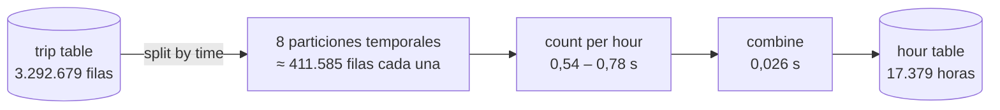
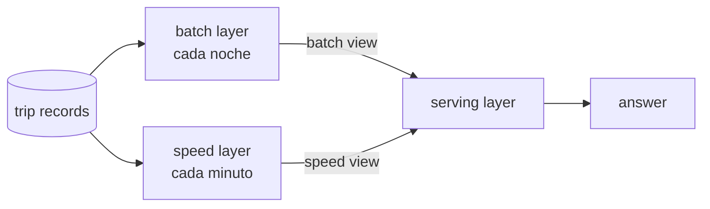
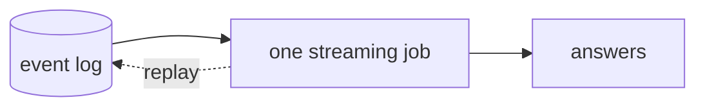
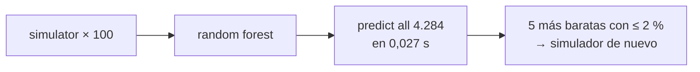

# 4. Management and processing of massive data — procesar millones de registros

Este bloque trata cómo procesar millones de registros: cuándo basta una máquina, cuándo dividir el trabajo, cuándo calcular (a horas fijas o según llegan los datos), cuándo muestrear y cuándo usar todas las filas, y cómo medir el rendimiento para que una diferencia sea fiable.

Objetivos del bloque:

- Encajar millones de registros en la memoria y el tiempo disponibles.
- Calcular a horas fijas (**batch**) o a medida que llegan los datos (**streaming**).
- Decidir entre muestrear o usar todos los registros.
- Medir de forma que una diferencia pueda considerarse real.

> **Por qué importa:** un código correcto que se queda sin memoria, responde tarde o se mide mal es un sistema fallido.

## El caso: la tabla de viajes

El ejemplo conductor vuelve a ser el servicio de bicicletas compartidas del [Bloque 3](../bloque-3/3-calidad-de-datos.md), pero ahora a nivel de **viaje** (*trip*): un alquiler de estación a estación. Cada **trip record** es una fila y la tabla tiene **3.292.679 filas** y siete columnas:

| Columna | Ejemplo | Significado |
| --- | --- | --- |
| `trip_id` | 1 | Identificador del viaje |
| `start_time` | 2011-01-01 00:05:09 | Inicio del viaje |
| `duration_min` | 7,9 | Duración en minutos |
| `start_station` | 62 | Estación de origen (1–300) |
| `end_station` | 118 | Estación de destino (1–300) |
| `user_type` | registered | `registered` o `casual` |
| `arrival_delay_s` | 1 | Segundos hasta que el registro llega al servidor |

Tamaño en disco: **CSV** (texto, una línea por fila) 165 MB; **Parquet** (comprimido, por columnas) 51 MB.

::: warning Origen de los datos
Los registros son **simulados** a partir de los recuentos horarios del UCI Bike Sharing dataset (Capital Bikeshare, Washington D. C., 2011–2012; Fanaee-T y Gama, 2013). Los totales horarios son reales; el resto de valores es simulado. Sirven para medir **procesamiento**, no para estudiar el comportamiento de los viajeros.
:::

Todas las cifras de este documento son las de los experimentos de las diapositivas (en una máquina de 2 núcleos); son ejemplos, no reglas universales, salvo que se indique.

---

## 4.1. Scalable data processing

### Cuándo los datos son demasiado grandes: decide el coste de la tarea

"Demasiado grande" significa que la tarea necesita más memoria o tiempo del disponible. Con 3.292.679 filas, la tabla entera ocupa **205 MB** en memoria: cabe. Lo que decide es la complejidad de la tarea, no el número de filas.

| Tarea | Complejidad | Efecto de duplicar filas | Resultado |
| --- | --- | --- | --- |
| Contar viajes por hora | $O(n)$ | 2× tiempo | 0,021 s |
| Búsqueda de todos los pares (misma estación en menos de 5 min) | $O(n^2)$ | 4× tiempo | ≈ 10,7 h estimadas |

Para estimar el tiempo antes de ejecutar sobre todas las filas, se mide con tamaños pequeños (2.000 → 0,026 s; 4.000 → 0,066 s; 8.000 → 0,227 s) y se extrapola:

$$
T(N) \approx T(n)\cdot\left(\frac{N}{n}\right)^2
\qquad
T(3\,292\,679) \approx 0{,}227\cdot\left(\frac{3\,292\,679}{8\,000}\right)^2 \approx 38\,450\ \text{s} \approx 10{,}7\ \text{h}
$$

**Veredicto:** las filas caben en memoria; el problema es la tarea $O(n^2)$ → rediseñarla o dividirla en partes que se ejecuten a la vez.

### Procesamiento por chunks (*out-of-core*)

- **Chunk:** bloque de filas que se lee y después se procesa.
- **Peak memory:** la máxima memoria usada en un instante.
- **Out-of-core:** solo un chunk está en memoria a la vez.

```text
for each chunk of 250,000 rows:
    count trips per hour
    add to totals
```

| Variante | Memoria pico del proceso | Tiempo |
| --- | ---: | ---: |
| Python y pandas sin datos | 193 MB | — |
| Fichero completo, luego contar | 638 MB | 6,9 s |
| 14 chunks de 250.000 filas | 197 MB | 8,3 s |

Ambas variantes producen los mismos **17.379 recuentos horarios**. La memoria atribuible a los datos baja de 445 MB a 4 MB, a cambio de +20 % de tiempo.

**Veredicto:** usar chunks cuando la memoria es el límite, y solo para resultados que **se pueden sumar** (sumas sí, mediana no).

### Partition · process · combine

Los chunks se ejecutan uno tras otro; para ganar tiempo hay que conseguir partes que se ejecuten **a la vez**.

- **Processor:** un núcleo, un proceso.
- **Partition:** los datos de un procesador.
- **Correct split:** partes **independientes**, **combinables** y **equilibradas**.



```text
split by time into 8 parts
count per hour in each part
add the 8 partial counts
```

Tiempos de las 8 partes: 0,59 · 0,58 · 0,61 · 0,62 · 0,64 · 0,55 · 0,54 · **0,78 s**.

**Veredicto:** correcto — los recuentos combinados coinciden con la tabla horaria; las partes no tardan lo mismo (0,54 frente a 0,78 s): **la más lenta marca el ritmo**.

### Speedup y efficiency

- $T_1$ / $T_p$: tiempo con 1 / $p$ procesadores.
- **Speedup** $S = T_1 / T_p$; ideal $S = p$.
- **Efficiency** $E = S / p$; ideal $E = 1$.

| $p$ | $T_p$ | $S$ | $E$ |
| ---: | ---: | ---: | ---: |
| 1 | 4,86 s | 1 | 1 |
| 2 | 2,82 s | 1,72 | 0,86 |
| 8 | 0,81 s | 6,0 | 0,75 |

$T_8$ = parte más lenta (0,78 s) + combinación (0,026 s). La máquina tiene 2 núcleos y la barra de $p = 8$ aparece discontinua: (aclaración editorial) parece un valor calculado a partir de los tiempos de las particiones, no una ejecución real con 8 núcleos.

**Regla: MEASURE · DIVIDE · STOP WHEN E FALLS.** Con 8 procesadores es 6,0× más rápido, pero $E$ baja de 0,86 a 0,75 → añadir procesadores solo mientras $E$ supere un límite escrito (p. ej. 0,7).

### Dos límites de la velocidad paralela

**1. La parte serie — ley de Amdahl.** La **serial fraction** $f$ es la proporción que solo puede hacer un procesador (aquí combinar + escribir = 0,061 s):

$$
f = \frac{0{,}061}{4{,}86} = 0{,}0126
\qquad
S(p) = \frac{1}{f + (1-f)/p}
\qquad
S(8) = 7{,}35,\quad S_{\max} = \frac{1}{f} \approx 79
$$

**2. Skew — partición desequilibrada.** Si se divide por estación, una partición contiene 1.983.708 filas (60 %) y todas esperan por ella: la más lenta tarda 3,53 s y la más rápida 0,20 s.

$$
S_8 = \frac{4{,}86}{3{,}56} = 1{,}4
$$

**Veredicto:** la parte serie es pequeña; el problema es el skew (división por tiempo 6,0× frente a división por estación 1,4×) → dividir por tiempo, o subdividir las estaciones más concurridas.

---

## 4.2. Patterns for distributed processing: batch, streaming, lambda architecture

### Batch y streaming

- **Event:** un registro que llega.
- **Batch:** trabajo sobre datos almacenados a horas fijas.
- **Streaming:** actualización con cada evento.

| | Batch | Streaming |
| --- | --- | --- |
| Ejemplo | A las 02:00 cuenta los viajes de ayer → informe para la ciudad | +1 por registro → viajes de los últimos minutos → responsable de operaciones |
| Antigüedad de la respuesta | hasta 26 h | ≈ 1 min |
| Completitud | datos completos | 99 % llega en 5 s; 0,83 % llega tarde |

```text
batch, nightly:    count yesterday, write tables
stream, per event: +1 to its minute; publish 2 min after it ends
```

**Regla: BATCH IF COMPLETE · STREAM IF FRESH.** Batch para el informe municipal (completo, puede esperar); streaming para el responsable de operaciones (necesita minutos). Ambos sobre los mismos registros.

### Ventanas y event time

- **Tumbling window:** franja fija de 1 minuto, sin solapamiento.
- **Event time:** inicio del viaje. **Arrival time:** momento en que el registro llega al servidor.
- **Allowed lateness:** 2 min.

**Regla: WINDOW BY EVENT TIME** — contar cada viaje en el minuto en que empezó, no en el que llegó.

```text
window = minute of start time
if window ended < 2 min ago: add 1
   else: late list → replay corrects it
```

Ejemplo: viajes por minuto el 12 sep 2012, 18:00–18:09 → 15, 21, 21, 25, 26, 18, 16, 19, 14, 14 (total 189).

**Veredicto:** 99,17 % se cuenta a tiempo; el 0,83 % (27.251) se corrige con el replay del log → fresco y correcto. Más lateness = menos registros perdidos, pero minutos publicados más tarde.

### Dimensionar el stream

- **Arrival rate** $\lambda$: eventos por segundo.
- **Bandwidth** $= \lambda \times$ bytes por evento.
- **Margin** $=$ eventos que procesa un procesador $/ \lambda$.

Hora más concurrida: 977 viajes (12 sep 2012, 18:00).

$$
\lambda = \frac{977}{3\,600\ \text{s}} = 0{,}271\ \text{eventos/s}
\qquad
\text{bandwidth} = 0{,}271\times 50{,}3\ \text{B} = 13{,}6\ \text{B/s}
\qquad
\text{margin} = \frac{4\,290\,196}{0{,}271}\approx 15{,}8\ \text{millones}
$$

(Como referencia, el día más concurrido, 8.714 viajes, da 0,1 eventos/s de media; por eso se dimensiona con la hora punta.)

**Veredicto:** una máquina sobra (incluso ×1.000 = 271 eventos/s) → el streaming se elige por **frescura**, no por tamaño.

### Lambda architecture

Batch es exacto pero tardío; streaming es fresco. Lambda combina ambos en una sola respuesta.

- **Batch layer:** exacta, todos los datos almacenados, cada noche.
- **Speed layer:** registros de hoy aún no incluidos en batch, cada minuto.
- **Serving layer:** batch + speed.



```text
night: batch view  = exact counts to yesterday
day:   speed view  = today's arrived records
query: answer      = batch view + speed view
```

Ejemplo: "viajes en septiembre hasta ahora", el 15 sep 2012 a las 14:30 → batch view (1–14 sep, exacto) 98.845 + speed view (hoy, llegados a las 14:30) 3.943 = **102.788** servidos. Valor exacto tras la noche siguiente: 102.789.

**Veredicto:** fresco y casi exacto (falta 1 viaje, se corrige la noche siguiente); **coste:** la lógica de recuento se escribe dos veces.

### Kappa architecture y cómo elegir

- **Event log:** eventos almacenados y ordenados, conservados durante un tiempo de retención.
- **Kappa:** un único job de streaming; para recalcular se reproduce (*replay*) el log. Aquí el replay de todos los viajes tarda 0,37 s.



| | Batch only | Lambda | Kappa |
| --- | --- | --- | --- |
| Respuesta en minutos | ✗ | ✓ | ✓ |
| Respuesta exacta | ✓ | ✓ tras la noche | ✓ tras un replay |
| Caminos de código | 1 | 2 | 1 |
| Recalcular el histórico | relanzar el job | relanzar la batch layer | releer el log |
| Encaja en el caso | ✗ | ✓ | ✓ |

```text
no answer needed within minutes → batch only
logic cannot run on a stream    → lambda
otherwise                       → kappa
```

**Veredicto:** kappa para el caso (se necesitan minutos, los recuentos son por evento, replay 0,37 s); lambda solo si el job nocturno necesita trabajo que un stream no puede hacer.

### Resumen de 4.1 y 4.2

| Regla | Idea |
| --- | --- |
| PARTITION · PROCESS · COMBINE | Partes independientes, combinables y equilibradas |
| MEASURE · DIVIDE · STOP WHEN E FALLS | $S = T_1/T_p$, $E = S/p$ |
| BATCH IF COMPLETE · STREAM IF FRESH | El plazo de la decisión elige el patrón |
| WINDOW BY EVENT TIME | Cada evento en su propio minuto |

En el caso: los chunks mantienen baja la memoria · 8 particiones temporales → 6,0× · un único stream kappa sirve a la ciudad y al responsable de operaciones.

---

## Segunda parte: responder con menos datos y medir bien

Objetivo: reducir datos de forma segura y medir la velocidad sin que el ruido engañe. Cuántos registros necesita una respuesta, cómo ajustar configuraciones cuando cada prueba es lenta y cómo obtener mediciones fiables. Procesar todo cuesta tiempo y dinero; medir mal lleva a decisiones erróneas. Media real de duración de los viajes: **18,07 min**.

## 4.3. Sampling, and when to process the full dataset

### Muestra y standard error

- **Population:** todas las filas. **Sample:** $n$ filas al azar.
- **Standard error** $SE = s/\sqrt{n}$: distancia típica de la media muestral a la media real.

| $n$ | Media muestral | SE |
| ---: | ---: | ---: |
| 100 | 17,52 | 1,73 |
| 1.600 | 17,63 | 0,443 |
| 25.600 | 17,99 | 0,114 |

Multiplicar las filas ×16 divide el error ≈ 4 (raíz de 16).

$$
SE = \frac{s}{\sqrt n}\ \rightarrow\ n=1\,600:\ \frac{17{,}72}{40} = 0{,}443\ \text{min}
\qquad
n = \left(\frac{s}{SE}\right)^2\ \rightarrow\ SE = 0{,}5:\ \left(\frac{18{,}38}{0{,}5}\right)^2 \approx 1\,351\ \text{viajes}
$$

::: warning Inconsistencia de la fuente
La diapositiva usa $s = 17{,}72$ en un cálculo y $s = 18{,}38$ en el otro. Probablemente uno es la desviación de la muestra de 1.600 y el otro la de la población, pero la fuente no lo aclara.
:::

**Regla: SAMPLE SIZE FROM THE ERROR YOU ACCEPT.** $SE = 0{,}5$ min (≈ ±1 min) requiere 1.351 viajes = 0,04 % de los datos → procesar todas las filas para una media desperdicia tiempo.

### Casos raros: una muestra puede no contener ninguno

- **Rare case rate** $\pi$: proporción de filas raras.
- $P(\text{ninguno en } n) = (1-\pi)^n$.
- **RSE** $= SE/\pi$ (error relativo).

Viajes de más de 3 h: 2.849 de 3.292.679 → $\pi = 0{,}000865$.

$$
P = (1-0{,}000865)^{1000} = 0{,}421
\qquad
\text{RSE } 10\,\%:\ n = \frac{1-\pi}{\pi\cdot 0{,}10^2} \approx 115\,500\ \text{viajes}
$$

En 2.000 muestras reales de 1.000 viajes, el 43 % no contenía ninguno.

**Veredicto:** una muestra dimensionada para la media falla con casos raros (hacen falta 85× más filas) → dimensionar por las filas más raras que necesite la decisión, o contarlas en los datos completos.

### Stratified sampling y pesos

- **Stratum:** grupo (aquí, tipo de usuario).
- **Stratified sampling:** número fijo de filas por estrato.
- **Weight** $w$ = proporción en la población / proporción en la muestra.

Población: `casual` 18,83 % (media 33,11 min) · `registered` 81,17 % (media 14,58 min). Muestra proporcional de 1.600 viajes: 301 + 1.299. La variación de la estimación baja de 0,461 (aleatoria) a 0,429 (estratificada), −7 %.

Si se rebalancea 50/50 (800 + 800):

| Estimación | Valor | Real 18,07 |
| --- | ---: | --- |
| Sin pesos | 23,64 | error de 5,6 min |
| Con pesos 0,377 / 1,623 | 17,98 | correcta |

```text
draw a fixed number of rows per stratum
estimate = Σ population share × stratum mean
if shares changed: weight each row by w
```

**Veredicto:** estratificar para que un grupo esté presente; **siempre reponderar** una muestra rebalanceada.

### Split first, then sample

- **Training rows:** el modelo aprende de ellas.
- **Test rows:** se apartan y se usan una vez para medir.

División temporal en el 7 ago 2012, 11:00: entrenamiento 2.427.794 viajes (muestra del 25 % = 606.948), test 864.885 viajes sin cambios.

```text
split by time
sample / stratify / reweight training only
measure on test as it is
```

**Regla: SPLIT FIRST · THEN SAMPLE.** El test tal cual da 17,72 min; rebalanceado 50/50 daría 23,84 min, un valor que el servicio nunca ve. Nunca se modifican las filas de test; muestrear el entrenamiento sí está permitido. (Relacionado con *sampling bias* y *leakage* del [Bloque 3](../bloque-3/3-calidad-de-datos.md).)

### Cuándo hacen falta todos los datos

| Pregunta | Resultado | Decisión |
| --- | --- | --- |
| Percentil 99 de duración | todos 90,8 min vs muestra 1 % 89,9 min | muestra: 1 % de error |
| Viajes de más de 3 h | todos 2.849 vs muestra 2.500 | todas las filas (la muestra falla un 12 %) |
| Viajes en sep 2012, informe municipal | 218.573 | todas las filas: total exacto |
| Tarifa de cada viaje | cada fila | todas las filas: facturación |

- **Todas las filas:** totales exactos, facturas, auditorías, filas raras.
- **Muestra:** medias, proporciones, percentiles hasta el 99, con su error.

```text
exact, billed or audited → all rows
depends on rare rows     → all rows or stratify
otherwise                → sample + its SE
```

**Veredicto:** medias y percentiles desde muestras; totales, tarifas y viajes raros desde todas las filas (aquí un recuento completo es barato).

### Evaluaciones lentas: probar configuraciones con un simulador

- **Simulator:** reproduce los 218.573 viajes de sep 2012; si no hay bicicleta, el viaje se pierde.
- **Configuration:** una elección de los cuatro ajustes.
- **Evaluation:** una ejecución del simulador → % de viajes perdidos.

| Ajuste | Valores | Opciones |
| --- | --- | ---: |
| Bicicletas por estación | 4–20 | 17 |
| Furgonetas | 0–20 | 21 |
| Bicicletas movidas por ronda | 10, 20, 30 | 3 |
| Horas entre rondas | 1–4 | 4 |

$17\times21\times3\times4 = 4\,284$ configuraciones. Tiempo total = configuraciones × tiempo por evaluación: a 0,50 s ≈ 36 min; a 5 min ≈ 15 días. En 100 probadas, los viajes perdidos van del 0,18 % al 18,08 %.

**Veredicto:** la elección importa; probar todo es viable a 0,5 s, no a 5 min → evaluar unas pocas y predecir el resto.

### Surrogate model

- **Surrogate:** modelo rápido entrenado con unas pocas evaluaciones.
- **Decision tree:** preguntas sí/no sobre las entradas.
- **Random forest:** muchos árboles; media de sus predicciones.
- **MAE** = media de |predicho − evaluado|.



Error sobre 100 configuraciones no probadas (MAE, puntos): media 2,915 · 1 árbol 0,632 · 10 árboles 0,487 · **100 árboles 0,404**.

Coste $= 300\times$ bicicletas por estación $+ 100\times$ furgonetas; objetivo: perdidos ≤ 2 %.

| Configuración | Predicho | Real | |
| --- | ---: | ---: | --- |
| 9 / 9 / 10 / cada 1 h | 1,76 | 1,66 | ✓ coste 3.600 |
| Igual, cada 2 h | 1,87 | 2,53 | ✗ |

**Regla: EVALUATE FEW · PREDICT ALL · CONFIRM THE BEST.** 105 evaluaciones en lugar de 4.284 (2,5 %); el bosque es el mejor surrogate → nunca fiarse de una predicción sola: confirmar con el simulador.

---

## 4.4. Performance analysis and challenges

### Dos tipos de rendimiento: calidad y recursos

- **Quality:** cuán cerca están las predicciones de la verdad (igual en cualquier máquina).
- **Resources:** tiempo (s), memoria (MB), energía (J) (solo válidos para esa máquina).
- **Latency:** tiempo por petición. **Throughput:** peticiones por segundo.

| Medida | Valor |
| --- | --- |
| Calidad: MAE en 3.476 horas de test | 32,69 viajes |
| Entrenamiento | 0,082 s |
| Fichero del modelo | 90,6 KB |
| Latencia (mediana) | 0,937 ms |
| Throughput | ≈ 941 / s |
| Memoria, energía | no medidas |

$$
\text{throughput} = \frac{1}{\text{mean latency}} = \frac{1}{1{,}063\ \text{ms}} \approx 941/\text{s}
$$

**Veredicto:** un tipo solo es incompleto → escribir un límite para cada uno (p. ej. MAE < 40 viajes, latencia < 10 ms) y comprobar ambos.

### Medir el tiempo: primera llamada, repeticiones y ruido

- **Wall-clock time:** tiempo transcurrido (`time.perf_counter`, resolución 1 ns).
- **Warm-up:** ejecutar antes de medir.
- **Noise:** variación del mismo código.
- **Tolerance:** menor diferencia real detectable.

Tiempo de una predicción: primera llamada 14,36 ms · segunda 3,48 ms · mediana tras warm-up 0,937 ms. Rango de las mediciones 0,847–1,396 ms (58 % de la mediana). Dos ejecuciones del mismo código: 0,945 y 0,959 ms (1,5 % de diferencia).

```text
warm up without measuring
30 repetitions × 100 calls → median each
compare medians, never single calls
```

**Regla: WARM UP · REPEAT · MEDIAN.** La primera llamada es 15× la mediana → una sola medición engaña; aquí diferencias menores de ≈ 2 % son ruido, no mejoras.

### La cola de la latencia

- **Tail latency:** extremo lento de la distribución.
- **p50** = mediana; **p99** = el 99 % es más rápido.
- Una página con $k$ llamadas es lenta si lo es una: $P = 1-(1-q)^k$.

Con 2.000 predicciones: p50 0,937 ms · media 1,063 ms · p99 2,125 ms · máx 3,951 ms.

$$
k = 10,\ q = 0{,}01:\quad P = 1 - 0{,}99^{10} = 0{,}096
$$

Es decir, el 9,6 % de las cargas de página sufre al menos una llamada lenta.

**Veredicto:** p99 = 2,3 × p50 y la media (1,063 ms) no describe a nadie → escribir los límites de latencia sobre p99, nunca sobre la media.

### Comparar dos versiones: ¿supera la diferencia al ruido?

- **A:** predecir desde una fila de tabla. **B:** desde un array simple.
- **Kruskal–Wallis:** compara grupos por rangos, sin suponer forma de campana.
- **p-value:** probabilidad de esta diferencia si A = B; aceptar si $p < 0{,}05$ (estricto: 0,01).
- **Control A vs A:** debe dar $p \ge 0{,}05$.

$$
H = \frac{12}{N(N+1)}\sum_i \frac{R_i^2}{n_i} - 3(N+1)
$$

$R_i$ = suma de rangos del grupo $i$; $n_i$ = su tamaño; $N$ = total.

| Comparación | Medianas | Resultado |
| --- | --- | --- |
| A frente a B | 0,945 vs 0,111 ms | $p = 2{,}87\times10^{-11}$, $H = 44{,}26$ → diferencia real |
| A frente a A (control) | 0,945 vs 0,959 ms | $p = 0{,}28$, $H = 1{,}16$ → máquina estable |

**Regla: TEST AGAINST THE NOISE.** B tarda un 88 % menos, $p$ diminuto y control estable → cambiar a B. Si el control diera $p < 0{,}05$, no se podría confiar en ninguna comparación. (Ver tests estadísticos en [Conceptos básicos de estadística](../bloque-1/1-5-conceptos-basicos-de-estadistica.md).)

### Profiling: dónde se va el tiempo antes de cambiar código

- **Profiler:** llamadas y tiempo por función (`cProfile`).
- **Cumulative time:** tiempo incluyendo las funciones llamadas.
- **Hotspot:** función con la mayor proporción.

Construir la tabla horaria fila a fila con 200.000 viajes: 60,65 s bajo el profiler (33,66 s sin él). El 46 % se va en leer filas una a una (`iterrows`): 200.001 llamadas, 28,05 s.

| Enfoque | Todos los viajes |
| --- | --- |
| Fila a fila | ≈ 9,2 min |
| Una operación (vectorizada) | 0,179 s |

≈ 3.000× más rápido y mismos recuentos.

```text
run under the profiler
sort by cumulative time
change the top function below the whole job
measure again; check same result
```

**Veredicto:** el profiler encontró el hotspot (≈ la mitad del tiempo); sustituirlo fue el único cambio necesario.

### Complejidad de McCabe y líneas efectivas

- **Effective lines:** ni en blanco, ni comentario, ni docstring.
- **Decision:** `if`, `elif`, `for`, `while`, `and`, `or` (no `else`).
- **McCabe** $M$ = decisiones + 1 = caminos independientes = tests necesarios.

```python
def hourly_table(trips):
    """Count valid trips per hour."""
    counts = {}
    for trip in trips:                    # decision 1

        # skip impossible records
        if trip.duration_min <= 0:        # decision 2
            continue
        if trip.start_station > 300:      # decision 3
            continue
        hour = trip.start_time.floor("h")
        if hour in counts:                # decision 4
            counts[hour] += 1
        else:
            counts[hour] = 1
    return counts
```

- Líneas efectivas $= 16 - 1 - 1 - 1 = 13$ (se descuentan línea en blanco, comentario y docstring).
- $M = 4 + 1 = 5$.
- Automático: `radon cc` → A (5) · `radon raw` → SLOC: 13.

**Veredicto:** $M = 5$ → 5 tests (viaje válido, duración 0, estación > 300, primer y segundo viaje de una hora); es baja — dividir funciones por encima de $M = 10$.

---

## Resumen de procedimientos

| Regla | Idea |
| --- | --- |
| SAMPLE SIZE FROM THE ERROR YOU ACCEPT | $n = (s/SE)^2$; las filas raras necesitan muchas más |
| SPLIT FIRST · THEN SAMPLE | Las filas de test nunca cambian |
| EVALUATE FEW · PREDICT ALL · CONFIRM THE BEST | El surrogate elige, el simulador confirma |
| WARM UP · REPEAT · MEDIAN | Una medición no es una medida |
| TEST AGAINST THE NOISE | $p < 0{,}05$ y un control estable |

### Retos de los datos masivos

| Reto | Qué hacer |
| --- | --- |
| Una partición tiene la mayoría de los datos (skew) | Dividir por tiempo o subdividir las estaciones más concurridas |
| Los registros llegan tarde | Contar por event time y hacer replay del log |
| La decisión depende de filas raras | Todas las filas, o estratificar por ellas |
| Cada evaluación es lenta | Surrogate y confirmar el mejor |
| Las mediciones tienen ruido | Warm-up, repeticiones y control A frente a A |

## Referencias relacionadas

- [3. Data quality](../bloque-3/3-calidad-de-datos.md) — mismo caso de bicicletas, CSV/Parquet, leakage y sampling bias.
- [1.4. Hardware Platforms and Basic Sizing](../bloque-1/1-4-plataformas-hardware-y-dimensionamiento-basico.md)
- [1.5. Basic Concepts on Statistics](../bloque-1/1-5-conceptos-basicos-de-estadistica.md)
- [2. Architecture and Design](../bloque-2/2-arquitectura-y-diseno.md)

## Material de referencia

Diapositivas suministradas para el Bloque 4, *Management and processing of massive data* (`SE4AI_Block4_Massive_data.pdf`, 28 diapositivas). La copia adjunta no se duplica dentro del repositorio.
