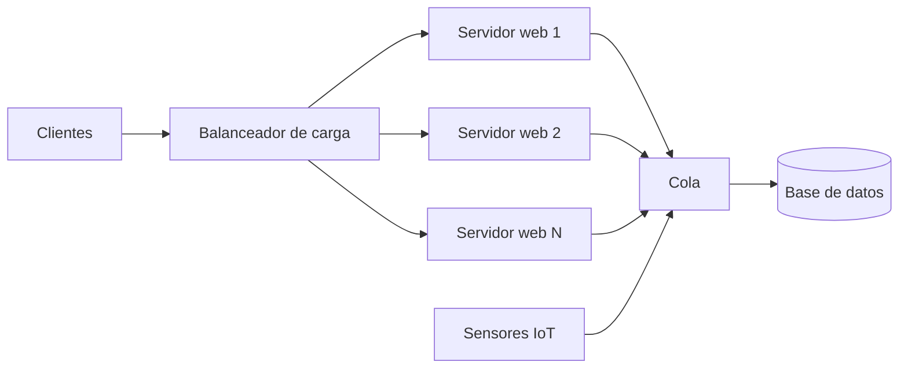
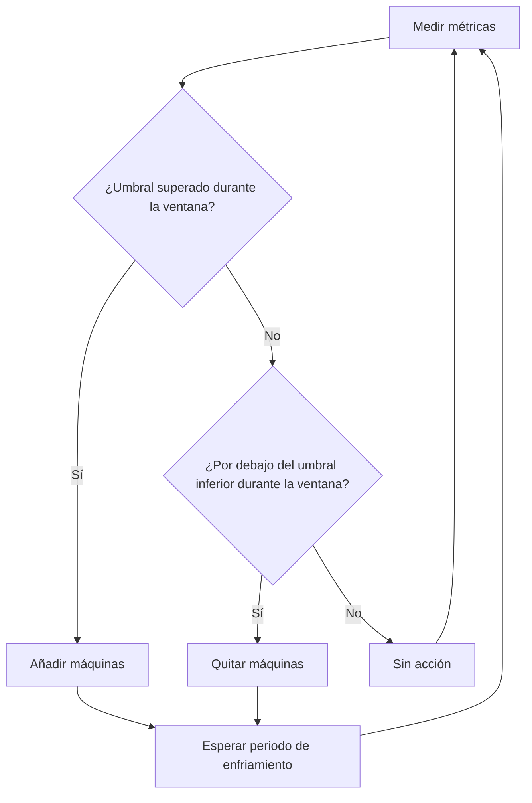
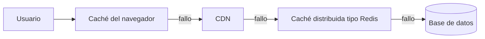
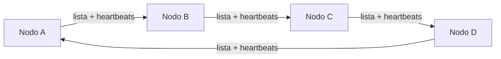

# Apuntes de clase — Miércoles 21 de octubre de 2026

## Escalabilidad, elasticidad, balanceo de carga, colas y gossip

> **Contexto:** Sistemas Distribuidos e IoT. Cierre del bloque 2 (elasticidad y escalabilidad): escalado vertical y horizontal, autoescalado, balanceo de carga, ley de Little, colas, cachés por capas, gossip como alternativa descentralizada y sensores IoT conectados a través de una cola.

La sesión termina el bloque 2 y deja para más adelante el material de apoyo del bloque 3. Los avisos logísticos sobre las prácticas se omiten.

## 1. Escalabilidad y elasticidad

- **Escalabilidad:** capacidad del sistema distribuido de crecer para atender más servicio.
- **Elasticidad:** escalabilidad en ambos sentidos, de acuerdo con la subida y bajada de la demanda. Los recursos se añaden y se retiran de forma automática y, según el docente, en minutos.

La demanda cambia por motivos concretos (una rebaja, un concierto, un pico diario), y no basta con que el sistema crezca. El docente lo compara con la memoria en informática: si el sistema solo añade recursos y nunca los libera, acaba saturado. Por eso, cualquier mecanismo que añade recursos necesita otro que los retire.

## 2. Piezas de un sistema elástico

Un sistema elástico necesita, como mínimo:

- **Balanceador de carga** (*load balancer*): reparte las peticiones entre las máquinas disponibles.
- **Autoescalador** (*autoscaler*): añade o retira máquinas según reglas sobre métricas.
- **Colas**: actúan como un buffer donde esperan las peticiones, sobre todo las escrituras.
- **Cachés**: evitan repetir trabajo y peticiones a los niveles más lentos.
- **Dimensionamiento inicial** correcto, calculado con la ley de Little (sección 6).

El esquema es una simplificación de la clase. Las escrituras pasan por una cola y solo una copia primaria tiene acceso a la escritura, como se vio en [30 de septiembre](clase-2026-09-30.md) y en [7 de octubre](clase-2026-10-07.md).

## 3. Escalado vertical y horizontal

### 3.1. Scale up y scale down

*Scale up* consiste en sustituir una máquina por otra más potente (más procesadores, más memoria, más disco). *Scale down* es lo contrario. Ejemplo de clase: pasar de una máquina de 4 procesadores a una de 8 o de 16.

| Aspecto | Scale up |
| --- | --- |
| Cambio | Hardware más potente |
| Software | Normalmente no cambia; el sistema operativo y las aplicaciones siguen instalados |
| Coste | Se paga la máquina nueva, y el coste se asume con más facilidad que una reescritura del software |
| Límite | Llega un punto en el que no hay máquinas más potentes que comprar |
| Velocidad | Lenta: requiere intervención física y comprobar que la imagen del sistema sigue funcionando |

El docente señala que el *scale up* es el primer camino que sigue casi cualquier organización. Solo se elige el escalado horizontal cuando el crecimiento lo exige o cuando el coste de reescribir el software compensa.

### 3.2. Scale out

*Scale out* añade máquinas en lugar de sustituirlas por una más potente. Plantea dos problemas:

- Hay que repartir las peticiones entre varias direcciones internas, por lo que se necesita un componente adicional, como un balanceador de carga. No tiene por qué ser un NAT, y puede basarse en URL y servicios HTTP.
- Para que una máquina nueva pueda atender a cualquier cliente, los servidores deben ser **independientes**: si no guardan estado de sesión, cualquiera puede responder a cualquier petición. Si hay 1000 clientes y cuatro servidores, cada servidor atiende en promedio unos 250.

### 3.3. Sesiones y estado

Cuando la aplicación mantiene sesiones de trabajo (por ejemplo, el carrito de la compra), hay tres opciones:

1. **Servidores sin estado.** Cualquier servidor atiende a cualquier cliente. El docente lo considera lo ideal.
2. **Estado en un almacén compartido**, accesible desde todos los servidores. Ejemplo citado: un almacén en memoria como Redis (clave-valor, datos en RAM).
3. **Estado en el cliente, mediante cookies.** La cookie contiene un identificador firmado por el servidor que la generó (si se modifica, se nota) y los datos de la sesión.

Si el estado queda en el servidor, el balanceador debe enviar siempre al mismo servidor a un mismo cliente. Eso se llama **sticky sessions** (sesiones pegajosas). Limita la elasticidad: si el servidor cae o se retira, la sesión se pierde o hay que moverla. Las bases de datos suelen comportarse así con sus escrituras, por lo que se replican y se fragmentan (*sharding*) para aliviarlas.

> **Aclaración editorial:** la transcripción dice «servidores en estado» en la frase sobre lo ideal. Por el contexto (la explicación anterior sobre sesiones) se entiende que el docente se refiere a servidores **sin estado**.

## 4. Por qué no basta con escalado manual

El *scale up* físico no se puede hacer en un minuto. Un sistema elástico necesita un mecanismo automático que responda en minutos, algo que el *scale up* no permite. En la nube, una API permite crear una máquina virtual con una imagen (por ejemplo, Ubuntu) que ya incluye el sistema operativo y la aplicación.

### 4.1. Ejemplo: venta de entradas para un evento

El docente plantea la venta de entradas de una convención que se abre un día concreto. Las peticiones empiezan en miles y pueden llegar a cientos de miles o a un millón por hora. Para planificarlo se necesita análisis del pasado: si no hay historial, hay que suponer el comportamiento.

Datos del ejemplo (cifras docentes, no universales):

- Un día con pico a mediodía que necesita hasta **8 máquinas**.
- Si se reservan 8 máquinas durante 9 horas, son **72 horas-máquina**.
- Sumando la demanda real de ese día (1 + 1 + 2 + 5 + 8 + 7 + 9), la carga real equivale a **33 horas-máquina**.
- Como la nube cobra por hora y por máquina, reservar 72 horas-máquina para 33 de uso desperdicia más del doble.

Alternativa: escalar por horas según el histórico. Entre las 8 y las 9 no se hace nada, de 9 a 10 se añade una máquina, de 10 a 11 se añaden tres y de 11 a 12, otras tres. Partiendo de una máquina, se llega a 8.

El docente recuerda dos supuestos de esta solución: que el servicio puede levantar máquinas virtuales en la nube y que la máquina física subyacente aguanta esas máquinas virtuales.

## 5. Autoescalado: el bucle de decisión

El autoescalador es un software que repite un bucle:

1. **Medir** una métrica (porcentaje de CPU, peticiones por máquina, conexiones activas, tamaño de cola).
2. **Comparar** la medida con los umbrales de la regla.
3. **Actuar**: añadir máquinas, quitarlas o no hacer nada.
4. **Esperar** un periodo antes de volver a decidir, para que la acción no se confunda con la carga real.

### 5.1. Reglas

Cada regla define, como mínimo:

- la **métrica** que se analiza;
- el **umbral**;
- el **tiempo** durante el que debe mantenerse (la decisión no se toma con un solo valor);
- la **intensidad** de la acción, normalmente como porcentaje de las máquinas actuales y no como número fijo;
- y, en la práctica, un **periodo de espera** tras cada acción.

Ejemplo docente: añadir máquinas si la CPU supera el 70 % durante 3 minutos, y después esperar 5 minutos. Quitar máquinas si la carga media queda por debajo del 30 % durante 10 minutos.

> **Aclaración editorial:** en la misma explicación aparece también un umbral de retirada del 50 % con una ventana de 10 minutos. La transcripción no permite confirmar cuál de los dos valores queda fijado; se consideran ejemplos, no reglas.

Puntos que el docente destaca:

- **Reglas asimétricas.** La regla de añadir protege a los clientes (que no se quedan sin servicio); la de quitar solo ahorra dinero. Por eso, la regla de retirada debe ser más conservadora.
- **Gradiente.** Si la demanda crece de forma no lineal (10, 20, 40, 100, 1000 peticiones por minuto), no conviene añadir un pequeño porcentaje. Se añade un porcentaje mayor (por ejemplo, el 30 %) y se vuelve a medir de inmediato.
- **Frecuencia de medición.** Lo habitual es cada minuto. Cada 30 segundos da mejor visión en sistemas muy dinámicos, pero carga el sistema con la propia monitorización. En sistemas muy estables pueden usarse intervalos de 2 o 5 minutos.
- **Realimentación.** Las acciones cambian las estadísticas, y las estadísticas cambian las decisiones. Si las reglas reaccionan a cada oscilación, el sistema se desestabiliza.
- **Varias métricas.** Si CPU, colas y peticiones reaccionan al mismo problema, cada una puede pedir más máquinas y el sistema se sobredimensiona (el docente pone el caso de añadir cinco cuando dos habrían bastado). Conviene combinarlas en una sola decisión.
- **Calibración.** Los umbrales se estiman con simuladores de cloud, que permiten probar cargas distintas. El docente menciona que también se pueden usar algoritmos de IA para sugerir umbrales o decisiones (tema de la asignatura de IA).

### 5.2. Arranque en frío y arranque en caliente

Una máquina nueva tarda en estar disponible. El ejemplo de clase es el siguiente:

| Fase | Tiempo orientativo (ejemplo docente) |
| --- | --- |
| Decisión y arranque de la máquina virtual | unos 20 s |
| Carga desde la red de la configuración y el software | unos 40 s |
| Recepción de datos de la caché (la máquina recibe peticiones pero aún no responde) | Hasta completar 90 s |
| Máquina disponible | a los **90 s**, aproximadamente un minuto y medio |

Esto es un **arranque en frío** (*cold start*). Un **arranque en caliente** (*warm start*) usa máquinas ya preparadas. El docente cita el caso de los *Prime Days* de Amazon: la elasticidad reactiva no basta, y se prepara un conjunto de máquinas con antelación.

Si la demanda crece de forma exponencial, el tiempo de arranque hace que el sistema llegue siempre tarde. Por eso, el autoescalado se combina con:

- un **mínimo de máquinas** siempre disponibles;
- una **previsión** del pico, con máquinas preparadas antes de que llegue.

El docente menciona también ataques de denegación de servicio que aumentan la carga de forma progresiva para que el sistema elástico siga creciendo. La transcripción no permite reconstruir el mecanismo concreto.

## 6. Balanceo de carga

### 6.1. Comprobaciones de salud

El balanceador mantiene un *pool* de máquinas sanas (*healthy*) y les envía una comprobación cada 10 segundos (ejemplo de clase). Según el docente:

- Un fallo puntual no basta para sacar una máquina del *pool*: se cuentan los fallos consecutivos.
- Si fallan **dos comprobaciones seguidas**, la máquina sale del *pool*. Con un intervalo de 10 segundos, la detección de una máquina caída tarda unos 20 segundos.
- Si una máquina responde de nuevo, el contador se reinicia y vuelve al *pool*.

### 6.2. Reparto de peticiones

- **Round robin:** se recorre la lista de servidores sanos en orden (0, 1, 2…). Si el 2 no está disponible, se sigue con 0, 1, 3. Al llegar al último, se vuelve al primero.
- **Por uso:** el reparto se basa en la CPU de cada máquina. Herramientas como CloudWatch mantienen esas estadísticas.
- **Por conexiones:** el propio balanceador conoce cuántas conexiones tiene abiertas con cada servidor, sin necesidad de que se lo informe nadie.

El reparto no tiene por qué ser exacto. Se usan rangos de tolerancia para que el sistema no oscile.

Los balanceadores y autoescaladores se configuran con reglas en un fichero. El docente cita NGINX como ejemplo de balanceador (la transcripción también menciona otro programa, que no se reconoce con fiabilidad).

### 6.3. El balanceador como cuello de botella

Todas las peticiones pasan por el balanceador, por lo que es un punto único de fallo y un cuello de botella. La solución habitual es tener un segundo balanceador que espera y toma la IP del primero si este falla.

## 7. Máquinas virtuales y máquinas físicas

El autoescalado opera sobre **máquinas virtuales** creadas y eliminadas mediante una API de la nube. Las máquinas físicas no se pueden crear o eliminar en un minuto, por lo que el modelo de elasticidad está orientado al servicio, no al centro de datos físico. En un centro de datos, los servidores acceden además a una capa de datos compartida. Por eso, la lógica de elasticidad se plantea sobre servicios y máquinas virtuales, y no sobre el hardware físico, que no se puede levantar ni retirar en un minuto.

## 8. Ley de Little

La ley de Little (atribuida en clase a John D. C. Little, MIT) relaciona tres magnitudes medias de un sistema estable:

`L = λ · W`

- **L:** número medio de peticiones dentro del sistema (concurrencia).
- **λ:** tasa media de llegada (peticiones por segundo).
- **W:** tiempo medio que una petición pasa dentro del sistema.

Los valores son medias de un intervalo (una hora, un minuto).

**Dimensionar.** Ejemplo docente: llegan 200 peticiones por segundo y cada una tarda 0,25 s. Entonces `L = 200 · 0,25 = 50`: el sistema debe atender 50 peticiones a la vez, es decir, 50 hilos o 50 núcleos equivalentes. Con 30 núcleos no basta y el sistema se degrada.

**Calcular capacidad.** Un *pool* de 20 conexiones y 0,25 s por petición permite atender como máximo `20 / 0,25 = 80` peticiones por segundo.

> **Aclaración editorial:** la transcripción dice «25» en la segunda cuenta, pero el resultado de 80 peticiones por segundo solo cuadra con 0,25 s, que es el tiempo del primer ejemplo.

Requisitos que menciona el docente:

- Hay que medir la tasa de llegada y el tiempo medio en un sistema real, durante un periodo representativo (la semana anterior, el año anterior).
- Las medias funcionan cuando las transacciones son homogéneas (carrito, notificaciones). Si el tiempo de los procesos varía mucho (un programa puede tardar un minuto y otro dos días), las medias son menos útiles.
- Para que no se acumulen retrasos, la capacidad de atención debe superar la tasa de llegada. La transcripción recoge esta condición de forma poco clara.
- El docente menciona dos sistemas con un parámetro de número máximo de conexiones que se deben configurar antes de desplegar. Los nombres de esos sistemas no son fiables en la transcripción; conviene consultarlos en el material.

## 9. Colas

### 9.1. Tasa de llegada y de servicio

Una cola crece cuando llegan más peticiones de las que se pueden servir. Ejemplo docente:

- Llegan **500** peticiones por segundo y el sistema atiende **100**.
- La cola crece a **400** peticiones por segundo.
- Tras **10 s** hay **4000** peticiones en espera.
- Para vaciarla a 100 peticiones por segundo hacen falta unos **40 s**, siempre que no lleguen más peticiones (supuesto que el ejemplo no detalla).

Una cola de 40 segundos ya es grande, y en servicios de gran escala es un problema. Por eso se mide la longitud de la cola al menos cada minuto.

### 9.2. Cola como disparador de escalado

El autoescalador puede medir el tamaño de la cola cada minuto:

- si supera un umbral, añade un trabajador (*worker*);
- si queda por debajo de otro umbral durante unos 10 minutos, retira un trabajador.

Gestionar la cola también consume tiempo y recursos, y las colas no están pensadas para cargas enormes: se vuelven tan lentas que el efecto es como si el sistema no funcionara. Además, una ráfaga de llegadas puede hacer imposible mantener el sistema, aunque las medias sean razonables.

### 9.3. Cola entre workers y base de datos

Poner una cola entre los trabajadores y la base de datos desacopla la velocidad a la que llegan las peticiones de la velocidad a la que la base de datos puede escribir. El docente menciona RabbitMQ como ejemplo de cola (en la transcripción aparece como «Rabbit»; el segundo nombre que cita no se reconoce).

Para el caso de sensores IoT (sección 11), la cola puede ser un broker de publicación/suscripción como MQTT, visto en [14 de octubre](clase-2026-10-14.md).

> **Aclaración editorial:** la transcripción atribuye a las versiones de Mosquitto una diferencia en el reparto de mensajes entre suscriptores. No es posible confirmarlo con fiabilidad. Para repartir mensajes entre suscriptores en MQTT existen las suscripciones compartidas de MQTT 5.0 (`$share`). Conviene verificar el detalle con las diapositivas.

## 10. Cachés en capas

### 10.1. Cachés de hardware y cachés distribuidas

Los procesadores tienen cachés L1, L2 y L3. En un sistema distribuido, una caché puede estar en el navegador o en un servicio que mantiene los datos en la RAM de un servidor, como Redis (clave-valor). El docente cita una base de datos grande cargada en 64 o 128 GB de RAM, sin leer el disco en cada consulta.

Según el docente, las cachés del procesador operan en microsegundos y las del sistema distribuido en milisegundos, unas mil veces más lentas.

> **Aclaración editorial:** en hardware, las latencias de L1, L2 y L3 se miden habitualmente en nanosegundos. La comparación del docente vale como orden de magnitud entre una caché local de procesador y una caché distribuida por red, no como cifra exacta.

### 10.2. Capas

El docente describe cuatro capas típicas en las aplicaciones distribuidas. Una petición se intenta resolver en la capa más cercana al usuario y solo pasa a la siguiente si falla:

- **Navegador:** responde en cuanto tiene el dato guardado, sin salir de la máquina del usuario.
- **CDN** (*Content Delivery Network*): nodos cercanos al usuario que guardan contenido estático o respuestas repetidas. Según el docente, con un CDN próximo, la ida y vuelta puede rondar los 10 ms; más lejos, unos 30 ms.
- **Caché distribuida** (Redis): datos en RAM, con respuesta rápida.
- **Base de datos:** la última capa y la más lenta.

### 10.3. Aciertos y tasa de fallos

Ejemplo docente con latencia de 40 ms al ir a la base de datos:

- Con un **80 %** de aciertos en caché, el 20 % de peticiones tarda 40 ms: `0,2 · 40 = 8 ms` de media.
- Con un **90 %** de aciertos, `0,1 · 40 = 4 ms` de media.

Para mejorar el promedio hay que aumentar la tasa de aciertos, no solo acelerar la base de datos. Cada caché guarda respuestas anteriores con un **TTL** (*time to live*): el dato caduca tras un tiempo (en el ejemplo, 5 minutos). Las respuestas son válidas solo durante ese tiempo.

No todo puede cachearse. El stock de un producto debe estar siempre en la base de datos: si una caché indica que quedan tres unidades cuando ya se han vendido, el sistema falla.

## 11. Cuello de botella en la base de datos

Si la base de datos acepta 1000 peticiones por segundo, el sistema no puede atender más de 1000 peticiones por segundo aunque tenga muchos servidores web. Las opciones que plantea el docente son:

1. **Caché** delante de la base de datos.
2. **Cola** que reciba las escrituras y las entregue a la base de datos a su ritmo.
3. **Sharding** (fragmentación): dividir la base de datos en partes que se escriben y leen en paralelo (ver [7 de octubre](clase-2026-10-07.md)).
4. **Aceptar datos antiguos** durante un tiempo, según el modelo de negocio. El número de «me gusta» de una página admite un retraso; el stock de un producto no, y si el negocio no admite datos antiguos, el sistema no estaría disponible en esos casos.

> **Aclaración editorial:** la transcripción menciona una sigla en la frase sobre los datos antiguos que no se reconoce. Por el contexto, el docente se refiere al compromiso entre consistencia y disponibilidad (el tema visto en [30 de septiembre](clase-2026-09-30.md)).

## 12. Gossip: membresía sin balanceador central

### 12.1. Motivación

El balanceador es un componente centralizado que conoce las máquinas disponibles. Si no se quiere depender de él, hay que conocer la lista de nodos de otra manera. El *gossip* (intercambio de información entre pares, «cotilleo») resuelve esa necesidad sin un servidor central. Cassandra es el ejemplo de clase.

### 12.2. Funcionamiento

1. Al arrancar, cada máquina tiene una **seed list** (lista semilla): dos o tres direcciones que le da el operador o la persona que la configura.
2. Cada segundo, la máquina elige una máquina al azar de su lista y le envía su lista de nodos, con un **contador de heartbeat** por nodo que aumenta cada segundo.
3. Al recibir dos listas que contienen el mismo nodo, se queda con el contador más alto.
4. Un nodo sin heartbeat durante los **últimos 10 segundos** se considera no disponible.

Así, la información se extiende por la red sin coordinación central.

### 12.3. Propagación y convergencia

En cada ronda, la información se transmite a un conjunto de nodos que, según el docente, se aproxima al doble del anterior. Tras 7 rondas (7 segundos) se han alcanzado `2^7 = 128` máquinas. Si la red tiene 100, la probabilidad de que todas estén actualizadas es alta, aunque no es una garantía formal y depende de cómo estén conectadas las máquinas (varias conexiones aceleran la actualización). Para tener certeza, habría que esperar más.

Las tablas son pequeñas: en el peor caso, 100 entradas, que ocupan del orden de 2 a 10 KB.

> **Aclaración editorial:** el docente dice que el contador de 32 bits tarda 68 años en llenarse a razón de un incremento por segundo. Con 32 bits sin signo, el valor máximo es 2^32 segundos, unos 136 años; los 68 años corresponden a 2^31 segundos, es decir, a un entero de 32 bits con signo. La idea (el contador no se desborda en la práctica) se mantiene.

Según el docente, en sistemas normales el gossip funciona bien, aunque siempre puede construirse un escenario en que falle. Se trata de **consistencia eventual**: la lista de nodos converge con el tiempo.

## 13. Esquema global

El docente cierra con un esquema del sistema completo:

- los usuarios llegan al balanceador;
- el balanceador reparte entre los servidores web;
- los servidores escriben a través de una cola hacia la base de datos;
- los sensores IoT no escriben directamente en la base de datos. Entre ambos hay una cola o un broker.

Sin cola, un sistema con miles de mensajes de sensores (una ciudad inteligente, un edificio, un vehículo autoguiado) satura la base de datos. El docente recomienda pensar en cada sistema IoT desde el punto de vista de dónde están los cuellos de botella.

El docente anuncia que una de las prácticas trabajará estos conceptos porque, según dice, los sistemas IoT funcionan así. La transcripción no permite identificar la práctica.

El docente también señala que IoT no se limita a ciudades: un coche o un edificio con motores, sensores y actuadores automáticos es un sistema IoT.

## Ideas clave

- **Elasticidad** es escalar hacia arriba y hacia abajo de forma automática y en minutos; un sistema que solo crece acaba saturado.
- El **scale up** es simple pero tiene límite de hardware; el **scale out** requiere servidores independientes o estado externo (cookies, almacén compartido o sticky sessions).
- El **autoescalado** repite medir, comparar, actuar y esperar. Las reglas de añadir y quitar máquinas son distintas, y se basan en umbrales sostenidos en el tiempo.
- Un arranque en frío puede tardar unos 90 segundos en el ejemplo de clase. La previsión y el arranque en caliente reducen ese retraso.
- El **balanceador** (con comprobaciones de salud y reparto round robin, por uso o por conexiones) es un punto único que se duplica con toma de IP.
- La **ley de Little** (L = λ·W) dimensiona la concurrencia necesaria y la capacidad de un *pool*.
- Las **colas** desacoplan la llegada de la atención: su tamaño se mide y puede disparar escalado.
- Las **cachés** en capas (navegador, CDN, Redis, base de datos) reducen la latencia media según la tasa de aciertos y el TTL.
- El **gossip** mantiene la lista de nodos sin servidor central, con convergencia eventual.

## Referencias relacionadas

- [Bloque 2 — Elasticidad y escalabilidad](../temario/bloque-2-elasticidad-y-escalabilidad.md)
- [30 de septiembre de 2026 — Replicación, escalabilidad y consistencia](clase-2026-09-30.md)
- [7 de octubre de 2026 — Sharding y replicación de fragmentos](clase-2026-10-07.md)
- [14 de octubre de 2026 — Hashing distribuido, publish/subscribe, multicast y MPI](clase-2026-10-14.md)
- [Notas de clase](index.md)

## Nota sobre la fuente

Apuntes elaborados a partir de `clase-iot-2110.json` (audio de unos 89 min 33 s según la marca temporal del archivo, con 875 segmentos de transcripción automática de una única voz, la del docente). La fecha se deduce del nombre del archivo (21/10) y de la pauta de clases de los miércoles. La transcripción altera con frecuencia siglas y nombres: se normalizan términos inequívocos como *gossip*, *load balancer*, *autoscaler*, *sticky sessions*, MQTT, CloudWatch, Cassandra, Redis, NGINX y la ley de Little. No son fiables los nombres de dos sistemas de conexiones máximas, la segunda herramienta de colas, la sigla de la sección 11 ni la frase sobre el estado de los servidores (véanse las aclaraciones). Se omiten avisos logísticos, pausas, fragmentos ininteligibles y artefactos del reconocimiento de voz. No se reconstruyen comandos ni nombres de práctica que no se oyen con claridad.
